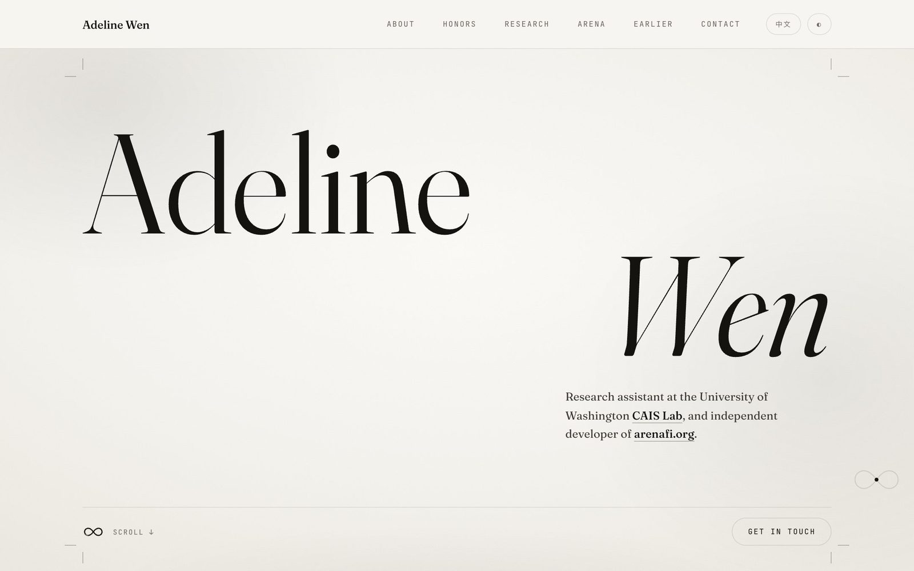
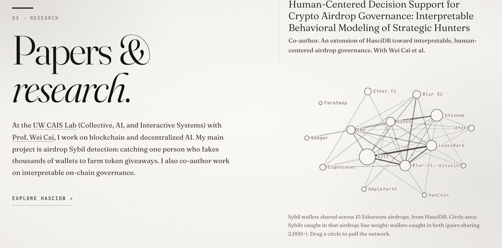
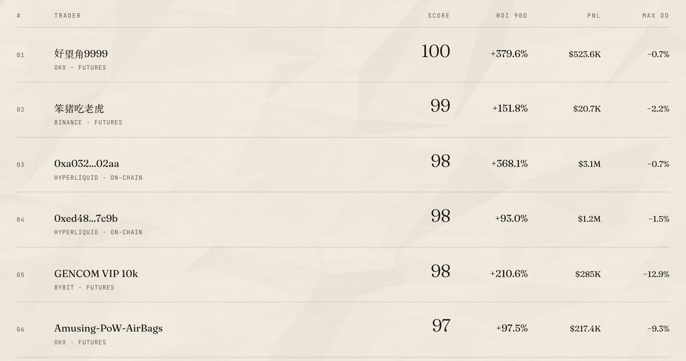
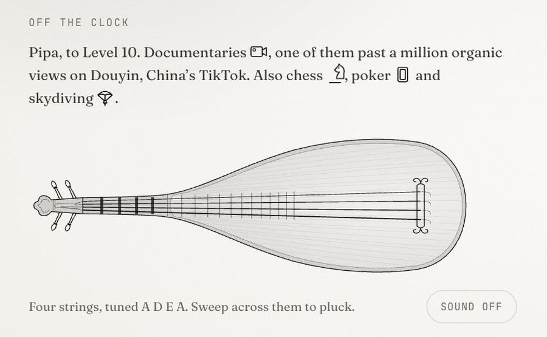

# adelinewen.com

The personal site of **Adeline Wen**: Economics at the University of Washington, research on crypto Sybil detection at the UW CAIS Lab, and founder of [Arena](https://arenafi.org).

**[adelinewen.com](https://adelinewen.com)** · [中文](https://adelinewen.com/zh) · [CV](https://adelinewen.com/Adeline-Wen-CV.pdf)



## What's on it

| | |
|---|---|
| **Research** | A force-directed map of Sybil wallets shared across 15 Ethereum airdrops, built from [HasciDB](https://hascidb.org) data. Circles can be grabbed and dragged; the network settles back under spring physics. |
| **Arena** | The live [arenafi.org](https://arenafi.org) leaderboard, typeset in the site's own type rather than shown as a screenshot. Fetched server-side once a day, with a committed snapshot as fallback. |
| **Off the clock** | A pipa drawn in SVG whose four strings can be plucked: damped-spring motion per string, and Karplus–Strong synthesis through the Web Audio API at the instrument's A D E A tuning (sound is opt-in). |
| **Talks & Earlier** | Photo reels and a photo wall served as AVIF/WebP at three widths. |

<p>
  
  
</p>

## Design

- **Ink on paper.** One near-black ink on warm paper; all hierarchy from scale, spacing and hairlines. Arena sits on newsprint to read as a printed table of results.
- **One system.** Every colour, size, radius, duration and easing comes from CSS custom properties in [`app/globals.css`](app/globals.css); components don't introduce their own values.
- **Motion that means something.** Lines draw themselves in on first view, ongoing roles breathe, and small marks move now and then. Animation runs only while on screen, pauses in background tabs, and is switched off entirely under `prefers-reduced-motion`.
- **Bilingual by URL.** `/` is English and `/zh` is Chinese, so a shared link opens in the language it was shared in. Language and theme changes use the View Transitions API.



## Stack

[Next.js 16](https://nextjs.org) (App Router) · React 19 · TypeScript · hand-written CSS on Tailwind v4's base layer · [d3-force](https://d3js.org/d3-force) · [Resend](https://resend.com) for the contact form · deployed on [Vercel](https://vercel.com)

## Structure

```
app/
  page.tsx, zh/page.tsx     English and Chinese entry points
  globals.css               design tokens and all styles
  api/contact/route.ts      contact form → email (Resend)
  opengraph-image.tsx       social card image, generated from the site's type
components/
  Site.tsx                  page layout, copy (EN/中文), navigation, reveals
  SybilMap.tsx, sybil.ts    research network (d3-force) and its data
  Leaderboard.tsx           Arena leaderboard
  OffClock.tsx, pipa.tsx    the pluckable pipa and interests
  PhotoStrip.tsx, PhotoWall.tsx
lib/arena.ts                leaderboard fetch, filtering and fallback snapshot
scripts/subset-cjk.py       builds the Chinese font subset from the site's own text
```

## Running locally

```bash
npm install
npm run dev        # http://localhost:3000
npm run lint
npm run build
```

The contact form needs `RESEND_API_KEY` (optional: `CONTACT_FROM`, `CONTACT_TO`). Without it the form falls back to opening the visitor's mail client.

After adding Chinese copy, rebuild the CJK font subset so new characters render in the site's serif:

```bash
curl -L -o /tmp/NotoSerifSC.ttf \
  "https://github.com/google/fonts/raw/main/ofl/notoserifsc/NotoSerifSC%5Bwght%5D.ttf"
python3 scripts/subset-cjk.py /tmp/NotoSerifSC.ttf
```

## License

© 2026 Adeline Wen. All rights reserved. Writing, photographs and the CV are not licensed for reuse.
